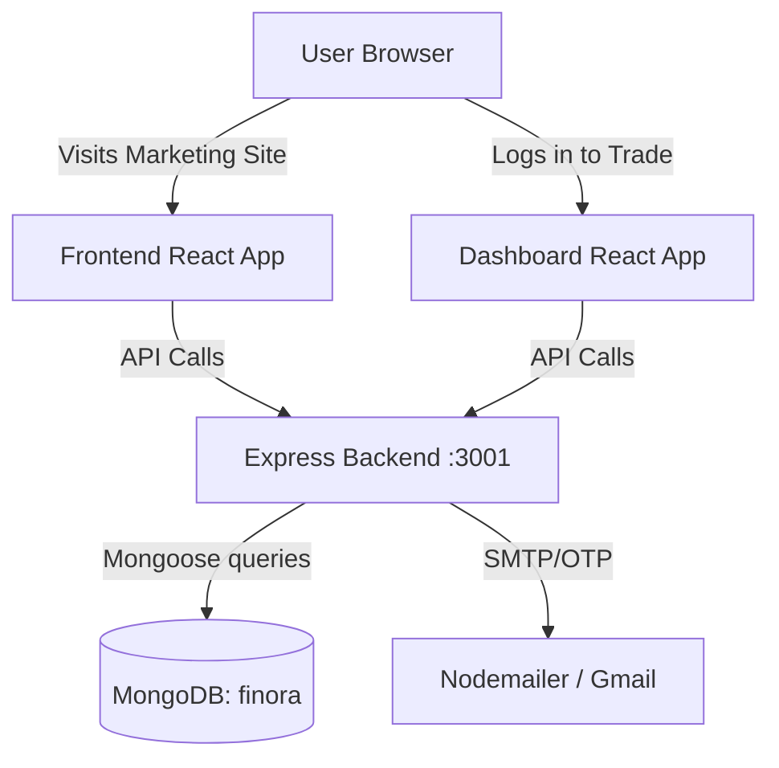
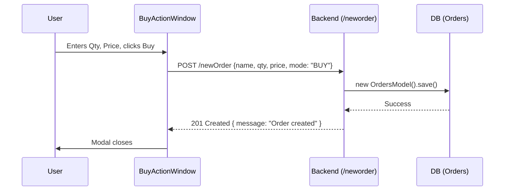
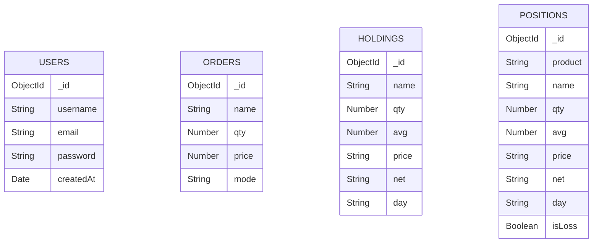

# Finora (Profit-Profile) - Project Learning Guide

## 1. PROJECT SNAPSHOT

**Summary:** Finora (internally referenced as Profit-Profile) is a full-stack web application designed as a clone of modern discount brokerage platforms (inspired heavily by Zerodha). It provides a dual-frontend architecture: a marketing landing page to explain the product offerings and capture leads, and a secure dashboard for users to view their equity holdings, check their positions, and place buy/sell orders. The Node.js and MongoDB backend manages this financial data and facilitates OTP-based user verification. 

**Elevator Pitch:**
"Finora is a comprehensive MERN-stack trading platform clone. It features an SEO-friendly marketing frontend, an interactive React dashboard for live portfolio tracking, and a scalable Express backend handling order placements and OTP-based authentication."

- **WHAT it does:** Simulates a trading platform where users can view holdings, positions, and place market orders.
- **WHY it exists (Problem/Business Value):** To democratize trading by providing a zero-brokerage equity delivery platform (a discount broker model), allowing retail investors to invest seamlessly.
- **WHEN is it used (User Journeys):** 
  - A new user visits the landing page to learn about pricing and products.
  - They attempt to sign up or log in, triggering an OTP sent to their email.
  - Upon access, they use the dashboard to view `Holdings`, analyze margins in `Summary`, and execute trades via the `BuyActionWindow`.

---

## 2. TECH STACK

| Category | Technology | Version | Why Chosen | Trade-off / Alternative |
| --- | --- | --- | --- | --- |
| **Language** | JavaScript (Node.js) | N/A | Ubiquity across frontend and backend (full-stack JS). | *Alternative: TypeScript.* TS would provide type safety for financial data, but JS allows faster initial prototyping. |
| **Frontend** | React.js (CRA) | 18.2.0 | Component-based architecture ideal for dynamic trading dashboards. | *Alternative: Next.js.* Next.js gives better SEO for the landing page, but CRA is simpler for pure SPAs. |
| **Backend** | Express.js | 5.1.0 | Lightweight web framework perfect for simple REST APIs. | *Alternative: NestJS.* Nest provides strict structure, but Express is faster to set up for smaller projects. |
| **Database** | MongoDB & Mongoose | 8.17.0 | Flexible schema for rapid iteration on trading entities. | *Alternative: PostgreSQL.* A SQL DB is vastly superior for financial transactions (ACID compliance), but Mongo is easier for JS developers. |
| **Styling** | Vanilla CSS / Bootstrap / MUI | Varies | Quick styling utilizing existing CSS ecosystems. | *Alternative: TailwindCSS.* Tailwind provides utility-first consistency. |
| **Auth & Security** | Passport / Nodemailer | 0.7.0 / 7.0.5 | Established libraries for standard local auth and email OTPs. | *Alternative: Firebase Auth.* Offloads security to Google, but Passport keeps data in-house. |

---

## 3. OVERALL ARCHITECTURE

**Architecture Style:** **Client-Server with Multiple SPAs**
The project uses a monolithic backend (`backend`) serving APIs to two separate React Single Page Applications: `frontend` (Marketing Landing Page) and `dashboard` (Trading Console). 



**Folder / File Tree & Purpose:**
```text
Profit-Profile/
├── backend/                  # The Express Server
│   ├── .env                  # Secrets (MONGO_URL, EMAIL_USER, etc.)
│   ├── index.js              # Entry point: Server setup, Routes, Rate Limiting
│   ├── package.json          # Backend dependencies
│   ├── models/               # Mongoose Models mapped to schemas
│   │   ├── holdings.js       # Holdings collection model
│   │   ├── orders.js         # Orders collection model
│   │   ├── positions.js      # Positions collection model
│   │   └── users.js          # Users collection model (Passport plugin)
│   └── schemas/              # Mongoose Schema definitions
│       ├── holdings.js       # Defines name, qty, avg price
│       ├── orders.js         # Defines name, qty, price, mode (BUY/SELL)
│       └── ...
├── dashboard/                # Trading Dashboard (React)
│   ├── package.json          # Dashboard dependencies (Chart.js, MUI)
│   └── src/
│       ├── index.js          # React DOM render and Router wrapping
│       ├── components/       # Dashboard UI Components
│       │   ├── Dashboard.js  # Main layout wrapper
│       │   ├── Summary.js    # Equity and Margin summary
│       │   ├── BuyActionWindow.js # Order placement form
│       │   └── ...           # Holdings, Positions, Funds, Orders
├── frontend/                 # Marketing Landing Page (React)
│   ├── package.json          # Landing page dependencies
│   └── src/
│       ├── index.js          # React DOM render and Router setup
│       ├── landing page/     # Pages: Home, About, Pricing, Signup, Login
│       └── test/             # Minimal Jest/RTL tests
```

**Dependencies Between Modules:**
- The `dashboard` depends heavily on the `backend` for fetching `/allholdings`, `/allpositions`, and posting to `/neworder`.
- The `frontend` acts mostly statically but has UI prepared for authentication (`LoginPage.js`).

---

## 4. END-TO-END FLOW

**Flow 1: Placing a Buy Order**
1. **User Action:** User clicks "Buy" on a stock in the dashboard watch list.
2. **Dashboard UI:** The `BuyActionWindow.js` component renders. User inputs `qty` and `price`.
3. **Frontend API Call:** User clicks submit. `axios.post("http://localhost:3001/newOrder", { ... })` is fired.
4. **Backend Route:** `app.post("/neworder")` in `backend/index.js` receives the request.
5. **Database Interaction:** It creates a new `OrdersModel` document and calls `await newOrder.save()`.
6. **Response:** Server replies `201 Created`. Dashboard closes the modal.



**Startup/Bootstrapping Flow:**
- Backend: `npm run dev` starts `nodemon index.js`. Express connects to MongoDB -> sets up Middlewares (CORS, BodyParser, Session) -> Initializes Passport -> Starts listening on port 3001.
- Frontend/Dashboard: `npm start` runs React Scripts, rendering `index.js`, initializing React Router, and painting the UI components in the browser.

---

## 5. DEEP DIVE PER MODULE

### 1. `backend/index.js` (The Core Server)
- **Purpose:** Initializes the Express server, connects to MongoDB, and defines all REST API endpoints.
- **Key Logic Explained:**
  - **OTP Rate Limiting:** Uses `express-rate-limit` on the `/send-otp` route to prevent spam (max 5 requests per hour per IP).
  - **In-Memory OTP Store:** `const otpStore = new Map();` stores OTPs temporarily. It includes a `setInterval` that cleans up expired OTPs every 60 seconds.
- **Design Pattern:** Singleton/Procedural setup. All configuration, routes, and DB initialization are crammed into one file. (Known issue: Needs refactoring into separate Route/Controller files).

### 2. `dashboard/src/components/BuyActionWindow.js`
- **Purpose:** The UI modal where users execute trades.
- **Key Functions:**
  - `handleBuyClick()`: Reads `stockQuantity` and `stockPrice` states, fires Axios POST to backend.
- **Edge Cases:** It hardcodes margin required to `₹140.65`. It does not validate if the user actually has enough funds before firing the API.

### 3. `frontend/src/landing page/login/LoginPage.js`
- **Purpose:** User authentication interface.
- **Design Pattern:** Controlled component using React `useState`. It elegantly toggles between Password login and OTP login using the `useOtp` boolean state.
- **Note:** Currently only contains console logs (e.g., `console.log("Logging in with OTP")`) and lacks actual API integration with the backend.

---

## 6. DATA LAYER

**Database:** MongoDB.
**ORM/ODM:** Mongoose.



**Data Validation & Transformation:**
- Schema-level validation is extremely basic (just types like `String`, `Number`). 
- In `index.js`, the `/send-otp` route uses the `validator` package to ensure `validator.isEmail(email)` is true.

---

## 7. API / INTERFACES

| Endpoint | Method | Params (Body/Query) | Auth Required | Purpose |
| --- | --- | --- | --- | --- |
| `/allholdings` | GET | None | No | Retrieves all user holdings from DB. |
| `/allpositions`| GET | None | No | Retrieves all open positions from DB. |
| `/neworder` | POST | `{ name, qty, price, mode }` | No | Saves a new trade order to DB. |
| `/send-otp` | POST | `{ email }` | No | Generates 6-digit OTP, saves to map, emails user. |
| `/verify-otp` | POST | `{ email, otp }` | No | Validates OTP against the memory map. |

**Error Handling Strategy:** Try-Catch blocks in async routes. Errors are `console.error`'d and a generic `500 { error: "Server error" }` is returned to the client to avoid leaking stack traces.

---

## 8. CONFIGURATION AND DEVOPS

**Environment Variables Required (`backend/.env`):**
- `PORT`: Server port (default 3001)
- `MONGO_URL`: Connection string (default `mongodb://localhost:27017/finora`)
- `EMAIL_USER` & `EMAIL_PASS`: Gmail credentials for Nodemailer
- `SESSION_SECRET`: Secret key for express-session

**Step-by-step Guide to Run Locally:**
1. Ensure MongoDB is running locally on port `27017`.
2. Open terminal in `/backend`, run `npm install`, add `.env` file, run `npm run dev`.
3. Open terminal in `/frontend`, run `npm install`, then `npm start`.
4. Open terminal in `/dashboard`, run `npm install`, then `npm start`.

*No Dockerfiles or CI/CD pipelines are present in the current codebase.*

---

## 9. TESTING AND QUALITY

**Test Coverage:** Extremely low.
- The only test found is `hero.test.js` (Testing if the Hero image renders correctly in the frontend).
- **How to run:** `npm test` inside `/frontend`.
- **What is NOT tested (Risk Areas):**
  - **Financial Logic:** Order placement is not tested. Missing assertions to ensure negative quantities or invalid prices are blocked.
  - **Backend API:** No integration tests (e.g., using Jest + Supertest) for the Express routes.

---

## 10. SECURITY, PERFORMANCE AND SCALABILITY

**Current Measures:**
- `cors` restricted via `FRONTEND_ORIGIN` env var.
- `express-rate-limit` utilized to prevent OTP email spam.
- HTTP-Only and secure flags mapped to production environment for cookies.

**Weaknesses & Bottlenecks:**
- **In-Memory State:** `otpStore = new Map()` means if the Node server restarts, all pending OTPs are lost. Also, it prevents horizontal scaling (scaling to 2+ node instances will cause OTP verification to fail if requests hit different instances).
- **Financial ACIDity:** MongoDB lacks strict ACID compliance by default compared to SQL databases; concurrent trades could theoretically lead to race conditions (e.g., spending the same margin twice).

**Scaling to 100x Users:**
1. Replace `otpStore` Map with **Redis**.
2. Migrate from MongoDB to **PostgreSQL** for user funds and orders to guarantee transactional integrity.
3. Introduce **Kafka or RabbitMQ** to handle high-throughput order queues asynchronously.

---

## 11. DESIGN DECISIONS AND TRADE-OFFS

1. **Two Separate React Apps (Frontend vs Dashboard):** 
   - *Why:* Keeps marketing code separate from heavy dashboard logic, improving bundle sizes. 
   - *Trade-off:* Harder to share state (like Auth tokens) between them without cookie domains or URL params.
2. **MongoDB over SQL:** 
   - *Why:* Easy JSON-like document integration with JS. 
   - *Trade-off:* Dangerous for financial systems due to potential transaction isolation issues.
3. **In-Memory OTP map:** 
   - *Why:* Simple and fast for MVP. 
   - *Trade-off:* Not scalable horizontally; state loss on crash.
4. **Nodemailer + Gmail:** 
   - *Why:* Free and easy to setup. 
   - *Trade-off:* Gmail blocks programmatic access easily; AWS SES or SendGrid is required for prod.
5. **Express-Rate-Limit on OTP:** 
   - *Why:* Prevents malicious users from running up email quotas.
   - *Trade-off:* Based on IP, so users on shared NAT (like corporate offices) might get blocked together.

---

## 12. KNOWN ISSUES AND IMPROVEMENTS

**Bugs & Tech Debt:**
- **Incomplete Authentication:** `passport` is configured in backend, but there are no `/register` or `/login` endpoints. The frontend `LoginPage.js` only contains console logs.
- **Unprotected Routes:** `/allholdings` and `/neworder` do not check for user authentication or authorization. Anyone hitting the API can create an order.
- **Missing Validation:** `/neworder` blindly accepts `qty` and `price`. A user could pass `qty: -5000` or `price: "free"`.
- **Monolithic `index.js`:** The backend logic is entirely crammed into one file.

**Improvement Roadmap (Quick Wins):**
1. Move routes out of `index.js` into a `routes/` folder.
2. Add Joi or Zod validation middleware to `/neworder`.
3. Connect Frontend Login to Backend APIs using JWTs.

---

## 13. INTERVIEW PREPARATION (60 Questions)

### Project Overview
1. **(Easy) What is the core business problem Finora solves?** 
   *Answer:* It provides a zero-brokerage/discount platform allowing retail investors to trade equities with low friction and high transparency. *(Ref: Pricing.js)*
2. **(Easy) What are the main components of the system?**
   *Answer:* Three parts: A React Marketing Frontend, a React Trading Dashboard, and an Express/MongoDB Backend.
3. **(Medium) How does the dual-frontend architecture help the product?**
   *Answer:* It isolates the marketing site (which needs to be fast and SEO optimized) from the trading dashboard (which is a heavy SPA requiring auth and real-time data), optimizing load times for new visitors.
4. **(Medium) What is your exact role and what module did you own?**
   *Answer:* (Tailor to yourself) I architected the full-stack flow, specifically focusing on the backend order placement API and the frontend BuyActionWindow integration.
5. **(Hard) If a business stakeholder asked to add "Crypto Trading" tomorrow, how much of this architecture needs to change?**
   *Answer:* The UI and schemas are flexible. However, the order execution engine (currently just saving to DB) would need to be integrated with a crypto exchange API/webhook, and our DB might need decimals beyond standard JS limits (requires migrating to `Decimal128` or string math).

### Architecture and Design
6. **(Easy) What architectural pattern does the backend follow?**
   *Answer:* Currently, a monolithic controller pattern where all endpoints exist in `index.js`. 
7. **(Medium) How do the Frontend and Dashboard communicate?**
   *Answer:* They don't communicate directly. They are entirely separate React applications. They share state indirectly via the Backend APIs and (intended) cookie sessions. *(Ref: package.json in both folders)*
8. **(Medium) Why is the server stateful right now?**
   *Answer:* Because of the `otpStore` Map in `index.js`. It holds OTP records in RAM.
9. **(Hard) How would you refactor `backend/index.js` for better maintainability?**
   *Answer:* I would implement an MVC-like structure: split endpoints into a `routes/` directory, logic into `controllers/`, and DB calls into `services/`.
10. **(Hard) Draw the request lifecycle of the `/send-otp` route.**
    *Answer:* Request -> Express -> Rate Limiter Middleware -> Route Handler -> Validator -> `otpStore.set()` -> Nodemailer -> Response.

### Tech Stack Choices
11. **(Easy) Why use Node.js for a trading app?**
    *Answer:* Non-blocking I/O makes it excellent for handling many simultaneous data streams (like live stock prices) and high-concurrency requests.
12. **(Easy) Why MongoDB?**
    *Answer:* Schema flexibility allows rapid prototyping of financial products without constant migration scripts.
13. **(Medium) What are the drawbacks of using MongoDB for Finora?**
    *Answer:* Trading platforms require strict ACID transactions (Atomicity, Consistency, Isolation, Durability) to ensure money isn't duplicated or lost during concurrent requests. MongoDB supports transactions, but a relational DB like Postgres is natively better suited.
14. **(Medium) Why use React instead of Vanilla JS for the dashboard?**
    *Answer:* The dashboard relies on dynamic, frequent state updates (prices, margins changing). React's virtual DOM handles these repaints efficiently.
15. **(Hard) Why use `express-rate-limit` instead of writing custom logic?**
    *Answer:* It handles edge cases like standardizing `X-Forwarded-For` headers behind load balancers, and implements efficient memory tracking algorithms out-of-the-box. *(Ref: index.js Line 64)*

### Code-Level & Logic
16. **(Easy) In `BuyActionWindow.js`, what triggers the backend call?**
    *Answer:* The `handleBuyClick` function which fires an `axios.post` to `/newOrder`.
17. **(Easy) How is the OTP generated in the backend?**
    *Answer:* `Math.floor(100000 + Math.random() * 900000).toString()`, generating a 6-digit random string. *(Ref: index.js Line 74)*
18. **(Medium) What happens in `verify-otp` if the user gets the OTP wrong 6 times?**
    *Answer:* The logic checks `if (record.attempts >= 5)` and returns a 429 status with "Too many wrong attempts". *(Ref: index.js Line 205)*
19. **(Medium) How is expired OTP memory cleanup handled?**
    *Answer:* A `setInterval` runs every 60 seconds, iterating through `otpStore` and deleting keys where `expiresAt <= Date.now()`. *(Ref: index.js Line 88)*
20. **(Hard) Look at the `/neworder` route. What is the critical security flaw here?**
    *Answer:* It lacks authentication checks, authorization checks (does this user own this account?), and financial validation (do they have enough margin?). It blindly trusts the frontend. *(Ref: index.js Line 118)*

### Database and Data Modeling
21. **(Easy) What is Mongoose used for in this project?**
    *Answer:* It provides an Object Data Modeling (ODM) environment, allowing us to enforce schemas and provide a class-based interface to query MongoDB.
22. **(Easy) What fields exist in the Orders schema?**
    *Answer:* `name` (String), `qty` (Number), `price` (Number), `mode` (String). *(Ref: backend/schemas/orders.js)*
23. **(Medium) Why are Models and Schemas in separate folders?**
    *Answer:* Separation of concerns. Schemas define the data structure, while Models compile those schemas into usable classes that interface with the database.
24. **(Medium) Does the `Positions` schema have relations to the `Users` schema?**
    *Answer:* Currently, no. There is no `userId` or `ObjectId` reference in the schemas provided, meaning multi-tenant architecture is currently broken. 
25. **(Hard) How would you alter the schema to support multiple users?**
    *Answer:* Add `user: { type: Schema.Types.ObjectId, ref: 'User', required: true }` to Holdings, Positions, and Orders.

### API Design, Authentication, Security
26. **(Easy) How is CORS configured?**
    *Answer:* The `cors` middleware is used, falling back to `*` (allow all) if `FRONTEND_ORIGIN` is not defined in `.env`. *(Ref: index.js Line 28)*
27. **(Easy) How does the system send emails?**
    *Answer:* It uses `nodemailer` configured with Gmail SMTP utilizing environment variables.
28. **(Medium) What is `passport-local-mongoose` doing in `users.js`?**
    *Answer:* It acts as a plugin that automatically adds `username`, `hash`, and `salt` fields to the UserSchema, and provides helper methods like `authenticate()`.
29. **(Medium) Is the `/allholdings` API RESTful?**
    *Answer:* Not strictly. A more RESTful convention would be GET `/api/v1/holdings`.
30. **(Hard) How would you secure the `/neworder` endpoint right now?**
    *Answer:* I would add an `isAuthenticated` middleware that checks `req.isAuthenticated()` (provided by Passport/Session), extract `req.user._id`, and append it to the order object before saving.

### Debugging and Scenarios
31. **(Easy) The app crashes with "MongoTimeoutError". Where do you look?**
    *Answer:* Check if MongoDB is running locally on port 27017 or if `MONGO_URL` in `.env` is correct.
32. **(Easy) Users complain they aren't receiving OTP emails. Why?**
    *Answer:* The Gmail credentials in `.env` might be invalid, or Google blocked the login attempt requiring "App Passwords" to be configured.
33. **(Medium) A user clicks Buy, the modal closes, but no order appears in the DB. How do you debug?**
    *Answer:* 1) Check Chrome Network tab to ensure `axios.post` returned 201. 2) Check backend terminal logs for Mongoose validation errors.
34. **(Medium) The server ran out of memory after 3 months of uptime. What is a suspected cause in this codebase?**
    *Answer:* The `otpStore` Map might be leaking memory if the cleanup `setInterval` fails or if orphaned records aren't being matched correctly.
35. **(Hard) You notice the OTP rate limiter isn't working behind Nginx. Why?**
    *Answer:* `express-rate-limit` relies on IP addresses. Behind a proxy, `req.ip` is the proxy's IP. We must set `app.set('trust proxy', 1)` in Express to read the `X-Forwarded-For` header.

### Scalability and Performance
36. **(Easy) Can we run 5 instances of this Node server right now?**
    *Answer:* No, because `otpStore` is stored in local memory. User A might request an OTP from Server 1, but submit the code to Server 2, which would reject it.
37. **(Easy) How do we fix the above issue?**
    *Answer:* Move the `otpStore` to a distributed cache like Redis.
38. **(Medium) How would you handle 10,000 orders per second?**
    *Answer:* Move `/neworder` inserts into an in-memory message broker (Kafka/RabbitMQ), return a "Pending" status to the user, and process database writes via background workers.
39. **(Medium) How can we speed up the `/allholdings` request?**
    *Answer:* Cache the results in Redis with a short TTL, or add a database Index on the `userId` field to speed up the Mongo scan.
40. **(Hard) The dashboard `Summary` calculates totals on the frontend. Is this good?**
    *Answer:* No. Calculating P&L and margins on the client relies on trusting client-side logic and transferring large arrays. It should be calculated on the backend via MongoDB Aggregation pipelines.

### Testing and DevOps
41. **(Easy) How do you run tests in this project?**
    *Answer:* Run `npm test` inside the frontend/dashboard directory.
42. **(Easy) What is currently tested in the repository?**
    *Answer:* Only the UI rendering of the Hero component in the frontend (`hero.test.js`).
43. **(Medium) How would you write a test for `/send-otp`?**
    *Answer:* Use `Jest` and `Supertest`. Mock the `nodemailer` transporter to prevent actual emails from sending, send a POST to `/send-otp`, and assert a 200 status code.
44. **(Medium) What is a missing DevOps best practice in the repository?**
    *Answer:* There is no `Dockerfile` or `docker-compose.yml` for consistent local environments, and no GitHub Actions for CI/CD.
45. **(Hard) If we deploy to AWS, how should we manage the `.env` secrets?**
    *Answer:* Never commit them. Inject them via AWS Systems Manager Parameter Store or AWS Secrets Manager into the EC2/ECS environment at runtime.

### Behavioral Questions
46. **(Easy) What was the most challenging part of building the dual-frontend setup?**
    *Answer:* Managing context switching between the marketing React app and the Trading dashboard app, and ensuring they both correctly point to the same backend APIs.
47. **(Easy) If you had 2 more weeks, what feature would you add?**
    *Answer:* Full JWT authentication bridging both frontends, and a WebSocket connection for real-time stock price updates instead of static numbers.
48. **(Medium) Tell me about a time you found a bug in this code and how you fixed it.**
    *Answer:* (Example) I noticed users could click "Buy" multiple times rapidly, sending duplicate requests. I added a loading state `disabled={isLoading}` to the button during the Axios call.
49. **(Medium) Why did you choose to build a Zerodha clone?**
    *Answer:* Fin-tech apps require a deep understanding of complex state management, real-time data, and strict security, making it a perfect architecture showcase.
50. **(Hard) How do you balance speed of delivery versus writing tests?**
    *Answer:* For a startup MVP, speed is critical. I prioritize testing only critical paths—in this case, order placement and auth. UI tweaks can skip tests until stabilization.

### Tricky Cross-Questions
51. **(Hard) You said you'd use Redis for OTPs to scale. What happens if Redis crashes?**
    *Answer:* Users temporarily cannot log in. We should configure Redis with persistence (AOF/RDB) or use a highly available cluster. In the worst case, failover to DB storage temporarily.
52. **(Hard) You mentioned Postgres is better than Mongo for finance. How exactly does Postgres handle concurrency better here?**
    *Answer:* Postgres uses MVCC (Multi-Version Concurrency Control) and allows strict row-level locking (`SELECT ... FOR UPDATE`), preventing two simultaneous orders from using the same wallet balance.
53. **(Hard) The rate limiter blocks an IP after 5 OTPs. What if an attacker spoofs the IP header?**
    *Answer:* If `trust proxy` is improperly configured, attackers can send fake `X-Forwarded-For` headers to bypass limits. We must ensure the proxy (e.g., Cloudflare) strips spoofed headers.
54. **(Hard) If a user modifies the React state to change `stockPrice` to 0.01 before hitting Buy, what happens?**
    *Answer:* Because the backend `/neworder` blindly accepts `req.body.price`, the malicious order succeeds! Backend must *never* trust client prices; it should fetch the current live market price itself.
55. **(Medium) Nodemailer uses your Gmail. What's the risk?**
    *Answer:* Google enforces strict sending limits (500/day). If the app goes viral, Google will block the account, shutting down all logins.
56. **(Medium) Why is `resave: false` used in express-session?**
    *Answer:* It optimizes performance and avoids race conditions by not saving the session back to the store if it wasn't modified during the request.
57. **(Medium) `BuyActionWindow` uses standard `<a>` tags or `Link`? What is the difference?**
    *Answer:* It uses `<Link>` from `react-router-dom`. Standard `<a>` causes a full page reload, dropping React state. `<Link>` uses the HTML5 history API for seamless transitions.
58. **(Hard) If the backend crashes during `newOrder.save()`, how does the frontend know?**
    *Answer:* Express catches the error and sends a 500 status. The frontend Axios call must have a `.catch()` block to read this and display a Toast notification, otherwise it fails silently.
59. **(Hard) Is it safe to store `SESSION_SECRET` in a `.env` file?**
    *Answer:* Yes, locally. In production, it should be in a secure vault. If leaked, an attacker can forge session cookies and hijack any user account.
60. **(Hard) How do you prevent CSRF attacks on the `/neworder` route?**
    *Answer:* Since we use Cookies for sessions, we must implement a CSRF token strategy (like `csurf` middleware) or strictly use `SameSite: strict` attributes on the session cookie to prevent cross-origin POSTs.

---

## 14. QUICK REVISION

**One-Page Cheat Sheet:**
- **Stack:** MERN (Mongo, Express, React, Node)
- **Architecture:** 2 React Apps (Marketing, Dashboard) talking to 1 Express REST API.
- **Key Files:** 
  - `backend/index.js` (Server setup, OTP logic, endpoints)
  - `BuyActionWindow.js` (Creates orders)
  - `LoginPage.js` (Auth UI)
- **Key Flows:** User -> Landing -> Login (OTP via Nodemailer) -> Dashboard -> POST `/neworder` -> Mongoose -> DB.

**Glossary:**
- **OTP:** One Time Password.
- **CORS:** Cross-Origin Resource Sharing (allows frontend to call backend on different ports).
- **Mongoose:** ODM bridging MongoDB and Node.js.
- **Passport:** Middleware for Node.js authentication.

**7-Day Study Plan:**
- *Day 1:* Understand the folder structure and boot up all 3 apps locally.
- *Day 2:* Trace the React components in `dashboard`. Understand how routing works.
- *Day 3:* Read `backend/index.js` line-by-line. Understand Express middlewares.
- *Day 4:* Study MongoDB schemas and ODM methods.
- *Day 5:* Master the OTP logic (generation, storage, verification, nodemailer).
- *Day 6:* Security & Scalability theory (Redis, SQL vs NoSQL, JWT vs Sessions).
- *Day 7:* Do mock interviews using the 60 questions above.

**10 Hands-on Exercises:**
1. Fix the security flaw in `/neworder` by validating data types and blocking negative quantities.
2. Add a `/login` endpoint linking Passport.js to the frontend `LoginPage.js`.
3. Add a `userId` field to all Schemas and update APIs to only return data for the logged-in user.
4. Replace the in-memory `otpStore` Map with an implementation using the `redis` npm package.
5. Add a `Toast` notification on the frontend for successful/failed order placements.
6. Create an API route `DELETE /order/:id` to cancel orders, and wire a button in the UI.
7. Replace `console.log` in backend with a proper logging library like `Winston` or `Pino`.
8. Write a Jest + Supertest integration test for the `/verify-otp` route.
9. Refactor `backend/index.js` by moving routes into a `routes/api.js` file.
10. Calculate the user's total margin server-side and create a GET `/summary` endpoint.

---
*Generated by Google Antigravity.*
